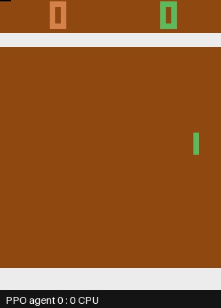
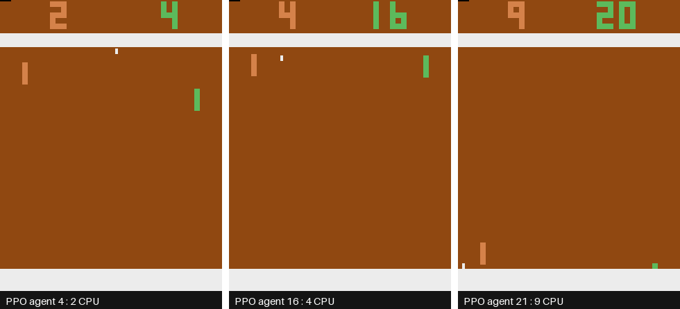
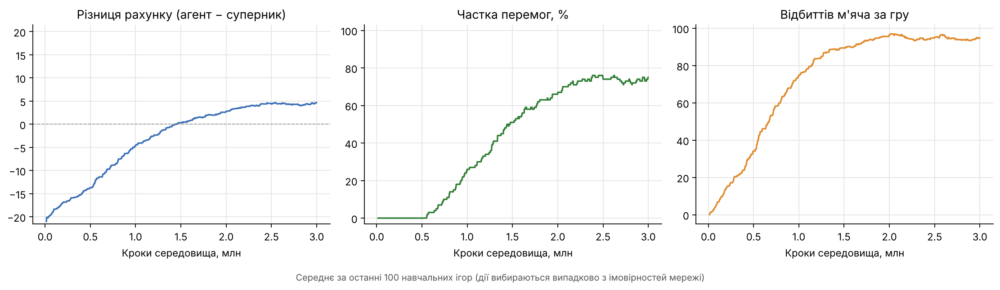

<div align="center">


### Нейронна мережа, що виграє в Atari Pong

Агент навчається методом **PPO** грати в Atari 2600 Pong проти вбудованого комп'ютерного суперника.<br/>
Гра йде до 21 очка — перемога однозначна: хто першим набрав 21.

<p>
  
  
  
  
  
</p>



<sub>Навчений агент грає праворуч зеленою ракеткою і доводить гру до 21 : 9.</sub>

</div>

---

## Навіщо це

Pong — класична перевірка для навчання з підкріпленням: простір дій крихітний (стоп, вгору, вниз), а сигнал
винагороди рідкий — очко трапляється раз на кілька секунд гри. Тут агент опановує її **з нуля, на чистому PyTorch
і на звичайному CPU**, без Ray і без відеокарти.

Основу взято з проєкту [TrainAI_Snake](https://github.com/YuriiDehtiar/TrainAI_Snake): той самий метод PPO, Actor
і Critic з окремими вагами, ті самі базові гіперпараметри (γ = 0,99, λ = 0,95, clip 0,2, ентропія 0,01, обрізання
градієнта 0,5). Змінено **середовище**, **вхід мережі**, **архітектуру** (повнозв'язна замість згорткової) та
**систему винагород**.

---

## Як агент грає

Фінальна модель зіграла **100 нових ігор** (`seed 900000–900099`) зі стандартними для ALE «липкими» діями
(sticky actions 0,25: з імовірністю 25 % приставка повторює попередню дію замість обраної). Ваги під час тесту не
змінювалися, мережа обирала найімовірнішу дію.

| Агент | Перемоги | Середній рахунок (агент : суперник) | Середня різниця |
|---|---:|:---:|---:|
| Випадкові дії (10 ігор) | 0 / 10 | 0,8 : 21 | −20,2 |
| **PPO, фінальна модель** | **98 / 100 (98 %)** | **21,0 : 9,9** | **+11,1** |

Приблизний 95 % інтервал частки перемог — 93,0–99,4 % (Вільсон). Дві поразки мінімальні: 20 : 21 і 19 : 21,
найкраща гра — 21 : 2. Повні дані кожної гри — у
[results/evaluation_final_100.json](results/evaluation_final_100.json).





Навчання тривало **3 млн кроків середовища (≈ 12 млн кадрів Atari) за 18 хвилин на 2 ядрах CPU**. Перша перемога в
навчальних іграх — на 0,55 млн кроків, позитивна середня різниця рахунку — на 1,44 млн кроків. На графіках дії
вибираються випадково з імовірностей мережі, тому навчальні показники (75 % перемог) нижчі, ніж у тесті з
найімовірнішою дією.

---

## Можливості

-  **Стан із RAM, а не з пікселів** — мережа отримує 10 підготовлених чисел, зчитаних прямо з пам'яті Atari 2600,
  тому навчається швидко й без згорток.
-  **PPO + GAE на чистому PyTorch** — Actor-Critic з окремими головами, без Ray і без GPU.
-  **16 паралельних ігор** — векторне середовище збирає досвід одразу з 16 партій на ітерацію.
-  **Бонус за відбиття** — м'який додатковий сигнал прискорює старт навчання, але на тесті не використовується.
-  **Відтворюваний тест** — 100 нових ігор на фіксованих seed зі «липкими» діями ALE.
-  **Запис гри в GIF** — будь-яку партію навченого агента можна переглянути або зберегти однією командою.

---

## Стан гри (вхід мережі)

Координати зчитуються з пам'яті (RAM) Atari 2600: `ram[49]`, `ram[54]` — м'яч X/Y, `ram[51]` — ракетка агента,
`ram[50]` — ракетка суперника.

| № | Ознака | № | Ознака |
|---|---|---|---|
| 1 | Y ракетки агента | 6 | швидкість м'яча по Y |
| 2 | Y ракетки суперника | 7 | Y м'яча відносно центру ракетки |
| 3 | X м'яча | 8 | відстань м'яча до ракетки по X |
| 4 | Y м'яча | 9 | м'яч у грі (0/1) |
| 5 | швидкість м'яча по X | 10 | м'яч летить до агента (0/1) |

Швидкості обчислюються як різниця координат між сусідніми кроками. Усі значення нормовані приблизно до [−1; 1].

## Будова мережі

| Частина | Розмір / налаштування | Активація |
|---|---|---|
| Вхід | 10 чисел | — |
| Actor | 10 → 256 → 128 → 3 | ReLU у прихованих шарах, Softmax у розподілі дій |
| Critic | 10 → 256 → 128 → 1 | ReLU у прихованих шарах, лінійний вихід |
| Дії | стоп, вгору, вниз | — |
| Параметрів | 71 940 | ортогональна ініціалізація |

## Винагороди

| Подія | Винагорода |
|---|---:|
| Агент виграв очко | +1 |
| Агент програв очко | −1 |
| Агент відбив м'яч | +0,1 |

Бонус за відбиття прискорює початок навчання: без нього перші тисячі розіграшів майже не дають позитивного
сигналу. Під час тестування бонус не використовується — перемога визначається лише рахунком гри.

## Налаштування PPO

[configs/training.json](configs/training.json): 16 паралельних ігор × горизонт 128 = 2048 кроків на ітерацію,
1464 ітерації, мінібатч 512, 4 епохи, Adam lr 3·10⁻⁴ з лінійним зменшенням до 0, γ = 0,99, λ_GAE = 0,95, clip 0,2,
обрізання value 10, коефіцієнт value 0,5, ентропія 0,01, обрізання градієнта 0,5, frameskip 4, sticky actions 0,25.

---

## Швидкий старт

```bash
python -m venv .venv && source .venv/bin/activate      # Windows: .venv\Scripts\activate
pip install -r requirements.txt
export PYTHONPATH=src                                   # Windows PowerShell: $env:PYTHONPATH="src"
```

ROM гри Pong постачається разом із пакетом `ale-py`, окремо завантажувати його не потрібно.

```bash
python -m pong_ppo.evaluate --checkpoint models/pong_ppo_final.pt --games 100 --seed 900000   # тест на 100 іграх
python -m pong_ppo.play --checkpoint models/pong_ppo_final.pt --show                           # показ гри
python -m pong_ppo.play --checkpoint models/pong_ppo_final.pt --gif results/pong_game.gif      # запис GIF
python -m pong_ppo.train --config configs/training.json --out runs/new                         # нове навчання
python -m pong_ppo.plot --log runs/new/training_log.csv --out runs/new/history.png             # графіки
```

---

## Під капотом

- **PyTorch 2.5.1** — мережа, PPO і GAE, без зовнішніх RL-фреймворків.
- **Gymnasium 1.0 + ale-py 0.12** — середовище Atari Pong і доступ до RAM приставки.
- **Actor-Critic** — дві окремі голови (10 → 256 → 128), ортогональна ініціалізація, 71 940 параметрів.
- **Векторне середовище** — 16 паралельних ігор, горизонт 128, 2048 кроків на ітерацію.
- **NumPy, Matplotlib, Pillow** — обробка стану, графіки навчання та запис GIF.

## Структура

```
configs/training.json        налаштування навчання
src/pong_ppo/env.py          середовище: ALE Pong, стан із RAM, винагороди, вектор із 16 ігор
src/pong_ppo/model.py        Actor-Critic
src/pong_ppo/train.py        PPO + GAE, журнал навчання, збереження моделей
src/pong_ppo/evaluate.py     тест на нових іграх
src/pong_ppo/play.py         показ гри / запис GIF
src/pong_ppo/plot.py         графіки навчання
models/                      pong_ppo_final.pt (фінальна), pong_ppo_iter400.pt (проміжна, 0,8 млн кроків)
results/                     журнал навчання, графіки, результати тесту, GIF
docs/report.pdf              короткий звіт
```
